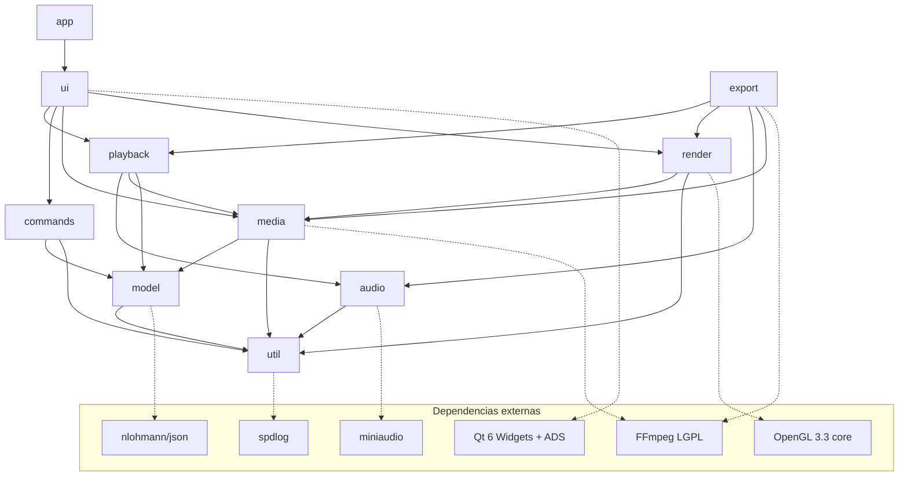
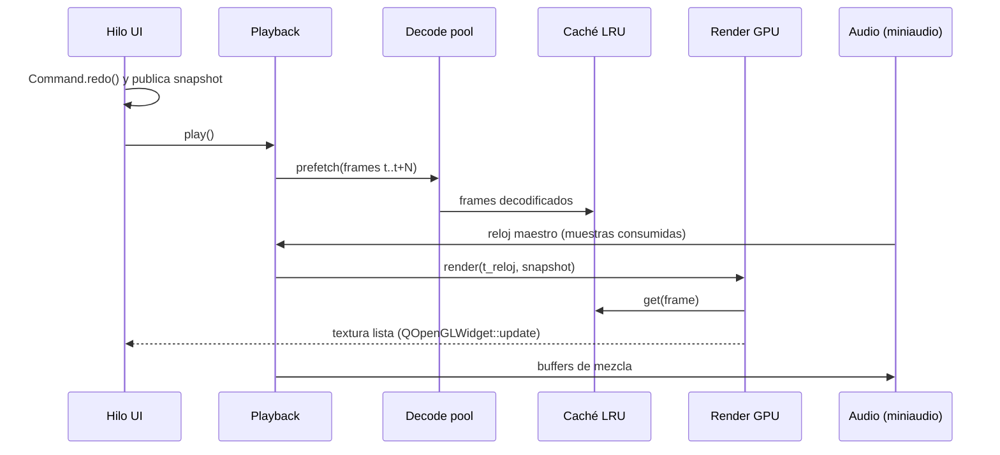

# Arquitectura de Loki

Loki es un editor de video no lineal (NLE) para PC, inspirado en el flujo de trabajo de Adobe Premiere Pro.
Este documento describe la arquitectura objetivo. Las secciones marcadas con **(decisión pendiente)** se
confirmarán antes de la fase indicada.

## 1. Principios

1. **Tiempo racional.** Toda posición/duración de edición es `loki::Rational` (numerador/denominador `int64_t`,
   normalizado, estilo `AVRational`). Prohibido `double`/`float` para tiempos de edición. `double` solo se permite
   en la frontera de presentación (píxeles de la timeline, medidores) y nunca vuelve al modelo.
2. **El modelo es la fuente de verdad** y no depende de la UI. La UI observa el modelo y lo modifica solo vía
   `Command`.
3. **Undo/redo ilimitado** (desde la Fase 2): toda mutación del modelo es un `Command` reversible.
4. **Hilos separados:** UI, decodificación (pool + caché LRU), render GPU, audio. **El reloj de audio es el maestro.**
5. **Mismo motor para preview y export.** El export usa el mismo grafo de render/mezcla, solo cambia el sumidero
   (pantalla vs. encoder) y el reloj (tiempo real vs. "lo más rápido posible").
6. **Nunca bloquear el hilo de UI** con I/O o decodificación (presupuesto: < 50 ms por evento).
7. **RAII estricto:** sin `new`/`delete` crudos, sin globales mutables. Recursos FFmpeg en `std::unique_ptr` con
   deleters dedicados (`AVFormatContextPtr`, `AVCodecContextPtr`, `AVFramePtr`, `AVPacketPtr`, ...).
8. Código, identificadores y comentarios en **inglés**; documentación de usuario en **español**.

## 2. Módulos

Cada carpeta de `src/` es una biblioteca estática CMake (`loki_<módulo>`). El ejecutable `loki` solo contiene
`app/main.cpp` y enlaza las bibliotecas. Las dependencias permitidas son **acíclicas** y se fuerzan en CMake.

| Módulo      | Responsabilidad | Depende de | Dependencias externas |
|-------------|-----------------|------------|-----------------------|
| `util`      | Logging, `Rational`, timecode, hilos/colas, helpers | — | spdlog |
| `model`     | Project, Sequence, Track, Clip, MediaItem, Effect, Keyframe, serialización | util | nlohmann/json |
| `commands`  | `Command`, `UndoStack`, comandos concretos de edición | model, util | — |
| `media`     | Probe, demux/decode FFmpeg, hwaccel, caché de fotogramas, thumbnails, waveforms, proxies | util, model (solo tipos de MediaItem) | FFmpeg |
| `render`    | Conversión de color, renderer GL; luego interfaz `RenderBackend`, compositor y efectos | media (tipos de frame) | Qt GUI/OpenGL (OpenGL 3.3) |
| `audio`     | Salida miniaudio (`AudioDevice`) y mezclador puro (`audio/mixer`) | util | miniaudio |
| `text`      | Rasterizado de títulos (QPainter sobre QImage, D21) | media | Qt GUI |
| `playback`  | Reloj maestro, motor de reproducción, sincronía A/V, scrubbing, J/K/L | audio, media, model, render_core, text, util | — |
| `export`    | Pipeline de exportación (mismo motor), presets, encoders | playback (grafo), render, audio, media | FFmpeg |
| `ui`        | Paneles: Project, SourceMonitor, ProgramMonitor, Timeline, EffectControls, AudioMeters | todos los anteriores | Qt Widgets |
| `app`       | `main`, ventana principal (dock manager), tema, workspaces, acciones y atajos | ui | Qt Widgets, Qt ADS |

Reglas:

- `model`, `commands`, `util` **no enlazan Qt Widgets**. Objetivo: tampoco Qt Core (ver §4), para que sean
  testeables y utilizables desde hilos de export sin event loop.
- `ui` nunca muta el modelo directamente: construye un `Command` y lo empuja al `UndoStack`.
- `media`, `render`, `audio` y `playback` trabajan sobre **snapshots inmutables** del modelo (ver §5), nunca
  sobre los objetos vivos que edita la UI.



## 3. Tiempo

- `loki::Rational { int64_t num; int64_t den; }` siempre normalizado (`den > 0`, `gcd == 1`), aritmética con
  detección de overflow (intermedios de 128 bits portables: MSVC no tiene `__int128`, usar helper propio),
  comparación exacta por multiplicación cruzada.
- Conversión a/desde `AVRational` en la frontera de `media`.
- La secuencia tiene `frameRate` (p. ej. `30000/1001`) y `sampleRate` de audio. Las ediciones de video se
  cuantizan a frame de secuencia; las de audio pueden ser a nivel de muestra.
- Timecode (`HH:MM:SS:FF`, drop-frame para 29.97/59.94) solo para presentación/entrada.

## 4. Modelo y comandos (decidido en Fase 2: D1–D4)

- **D1 – Modelo en C++ puro.** `src/model` no depende de Qt. `Project` notifica cada cambio con un
  `ChangeEvent` (tipo, id, contenedor) a los `ProjectObserver` registrados. El adaptador
  `ui::ProjectController : QObject` convierte esos eventos en señales Qt, es dueño del `Project` y del
  `UndoStack`, expone las acciones Undo/Redo y carga/guarda en un hilo de trabajo (`QtConcurrent`).
- **D2 – Solo los Commands mutan.** La API pública de `Project` es de solo lectura (referencias `const`). La
  única escritura es `ProjectMutator`, cuyo constructor es privado y solo accesible a `commands::Command`
  (vía `Command::mutate()`) y a `ProjectBuilder`. `ProjectBuilder` solo crea proyectos nuevos (cargar, plantillas,
  tests). Toda operación del mutator valida invariantes y, si falla, lanza `ModelError` sin cambiar nada.
- **D3 – Formato `.loki`.** JSON con `format`/`version`, tiempos `[num, den]`, IDs UUID v4 y ruta absoluta +
  relativa de los medios. Detalle en `docs/PROJECT_FORMAT.md`.
- **D4 – Sin solapes.** Los clips de una pista están ordenados por `start` y no se solapan. Insertar/sobrescribir
  (Fase 5) resolverán los solapes con macros de comandos.

```
Project
 ├─ MediaItem[]        (id, nombre, ruta, proxy, bin, MediaInfo)
 ├─ Bin[] (árbol)      (id, nombre, parent)
 └─ Sequence[]
     ├─ settings       (resolución, frameRate, sampleRate)
     ├─ videoTracks[] / audioTracks[]  (id, TrackState: nombre, locked, hidden, muted)
     │    └─ Clip[]    (id, media, start, sourceIn, duration, enabled, link)
     │         └─ Effect[] → Parameter[] → Keyframe[] (tiempo en el *source*, valor, Hold/Linear/Bezier)
     └─ (Transition[] en Fase 9, con migración de formato)
```

- Los tiempos de los keyframes están en el tiempo del *source* del clip, así siguen al contenido al mover, recortar
  o dividir.
- `Command`: `redo()`/`undo()`/`text()`; la primera ejecución valida y tiene garantía fuerte (si falla, no cambia
  nada). `MacroCommand` agrupa y revierte a los hijos ya aplicados si uno falla.
- `UndoStack`: ilimitado, macros anidadas (`MacroGuard` RAII), estado "limpio" (guardado) y `Point` +
  `markCleanAt()` para guardados asíncronos.
- **Fusión por gesto:** comandos con el mismo `GestureId` distinto de cero (un arrastre, un slider) se funden en un
  solo paso de undo; con `GestureId` 0 nunca se funden. La UI pide ids con `ProjectController::newGestureId()`.
- Los clips de pistas bloqueadas no se pueden editar. Se comprueba solo en la primera ejecución, así undo/redo
  siempre reproducen fielmente.
- Copiar un `Project` copia los datos pero no los observadores: sirve como snapshot barato para otros hilos.

## 5. Concurrencia y flujo de datos

| Hilo | Trabajo | Comunicación |
|------|---------|--------------|
| UI (main) | Eventos, pintado de widgets, aplicación de Commands | Publica snapshot nuevo tras cada Command |
| Decode pool (N = núcleos − 2) | Demux/decode, hwaccel, escalado, thumbnails, waveforms, proxies | Colas de peticiones con prioridad; resultados a caché LRU |
| Render | Contexto GL propio (compartido con QOpenGLWidget), composición, efectos | Pide frames a la caché; entrega textura al monitor |
| Audio (callback miniaudio) | Mezcla en tiempo real, **reloj maestro** | Ring buffer lock-free alimentado por el mezclador; sin locks ni alloc en el callback |

- **Snapshot del modelo:** tras cada Command, la UI publica un `std::shared_ptr<const SequenceSnapshot>`
  (copia estructural barata). Los hilos de playback/render/export leen el puntero atómicamente. Sin locks sobre el
  modelo vivo.
- **Sincronía A/V:** el `MasterClock` avanza con las muestras efectivamente consumidas por el dispositivo de audio
  (corrigiendo la latencia reportada). El render presenta el frame cuyo PTS corresponde al reloj; si va tarde, lo
  descarta (cuenta "dropped") en vez de desincronizar. Sin audio, reloj de sistema monotónico.
- **Scrubbing:** peticiones de "último gana" (se cancelan peticiones obsoletas), seek al keyframe más cercano +
  decode hacia delante, prioridad máxima en el pool; objetivo < 100 ms.



## 6. Render

- Interfaz `RenderBackend` (crear texturas, subir planos YUV/RGBA, ejecutar pasada de efecto, leer a CPU para
  export). Implementación MVP: `GLRenderBackend` (OpenGL 3.3 core). Migración futura: QRhi / Vulkan / D3D11 sin
  tocar compositor ni efectos (los efectos declaran parámetros + shader por backend).
- Espacio de trabajo: RGBA 16F lineal; conversión YUV→RGB en shader (BT.601/709 según metadatos, rango
  limitado/completo).
- Orden por pista: decode → conversión de color → efectos de clip (Movimiento, Opacidad, color, LUT) →
  transición → mezcla con modo de fusión sobre la pista inferior.
- Calidad de reproducción (completa, 1/2, 1/4) = resolución del framebuffer de composición.

## 7. Media (Fase 3)

- `media::probeMedia` (libavformat) lee resolución, fps, duración, códecs, audio y si es imagen fija. Se ejecuta en
  el pool, nunca en la UI.
- `media::VideoDecoder`: un decodificador por hilo y precisión de fotograma.
  - `frameAt(t)` devuelve el último fotograma con `pts <= t`. Si `t` está a menos de 2 s hacia delante sigue
    decodificando; si no, busca el keyframe anterior y decodifica hasta `t`.
  - `framesUpTo(t)` decodifica un GOP completo; sirve para reproducir hacia atrás.
  - Aceleración por hardware en orden D3D11VA, CUDA/NVDEC y DXVA2. El primer fotograma se prueba y, si falla, se
    vuelve a software. Los fotogramas de hardware se copian a RAM (D6).
  - Salida en YUV420P o NV12 (la GPU hace la conversión) o RGBA (miniaturas), con escalado opcional según la calidad
    de reproducción.
  - Tiempos relativos al inicio del medio (0 = primer fotograma), igual que `Clip::sourceIn`.
- `media::AudioDecoder` convierte a float32 intercalado a una frecuencia fija (swresample). El seek tiene precisión
  de muestra: descarta o rellena hasta el instante pedido.
- `media::FrameCache`: LRU con límite en bytes, thread-safe. Clave = (fuente, calidad, índice de fotograma).
- `media::MediaCache`: caché en disco (`MediaCache/<tipo>/<clave>.<ext>`). La clave es un hash FNV-1a de ruta,
  tamaño y fecha de modificación. Guarda miniaturas JPG y waveforms `.lkwf` (formato binario propio con
  picos min/max en int16). Se configura en Preferencias; en la máquina de desarrollo está en `F:\LokiCache`.
- `util::TaskPool`: pool con prioridades (Interactive > High > Normal > Background) y cancelación cooperativa. Por
  defecto usa núcleos − 2 hilos.
- UI: `ui::MediaServices` agrupa pool, miniaturas, waveforms e importación (probe en paralelo y un único
  `MacroCommand` de undo). `ui::ProjectPanel` / `ProjectItemModel` muestran bins y medios.

## 7b. Reproducción (Fase 4)

- `audio::AudioDevice`: miniaudio en la app (48 kHz estéreo, periodo de 10 ms) y `ManualAudioDevice` en los tests.
  El callback solo lee un `util::SpscRing` sin locks.
- `playback::PlaybackClock`:
  - A ×1 con audio: tiempo = ancla + (muestras consumidas por el dispositivo − latencia) / frecuencia.
  - Con J/K/L a otras velocidades, hacia atrás o sin audio: reloj monotónico × velocidad (`TimeSource` inyectable).
- `playback::PlaybackEngine`:
  - Hilo de medios propio. La UI solo envía peticiones (la última gana) y consulta `currentFrame()`/`position()`
    cada 10 ms.
  - Hacia delante mantiene ~8 fotogramas decodificados por adelantado. Si va más de 0,5 s por detrás, salta al
    reloj en vez de decodificar todo lo pendiente.
  - Hacia atrás usa `framesUpTo` por GOP y la caché.
  - El fotograma mostrado lo elige el reloj; los que llegan tarde se descartan y se cuentan en `PlaybackStats`.
  - Al llegar al final (o al inicio en reversa) se pausa.
- `render::GlFrameRenderer`: OpenGL 3.3 (shaders `#version 330 core`, contexto de compatibilidad). Sube los planos como texturas R8/RG8/RGBA8 y el shader convierte
  YUV a RGB con la matriz BT.601/709 y el rango limitado/completo de `render::yuvToRgb`. Esa misma función es la
  referencia en CPU que usan los tests.
- `ui::VideoView`: no es un `QOpenGLWidget`. Es una ventana nativa `QOpenGLWindow` incrustada con
  `createWindowContainer`. Con un `QOpenGLWidget`, toda la ventana principal se veía en blanco en la Intel
  HD 620 (no se confirmó la causa). Con la ventana nativa, el resto de la UI sigue dibujándose por la ruta
  normal (raster).
- `ui::SourceMonitorPanel`:
  - `VideoView` y `ScrubBar`.
  - Timecode con drop-frame cuando corresponde.
  - Calidad completa, 1/2 o 1/4.
  - Teclas: Espacio, J/K/L, ←/→ (Shift = 5 fotogramas), I/O, Shift+I/O, Home/End y Ctrl+Shift+X.
  - Las marcas In/Out se guardan en el `MediaItem` como comandos con undo (D9). Out es exclusivo.

## 7c. Línea de tiempo y edición (Fase 5)

- **Ediciones como diferencias.** `commands::EditPlan` trabaja sobre una copia de las pistas afectadas:
  - Operaciones: `clearRange`, `splitAt`, `shiftFrom`, `add`, `take`.
  - `build()` valida la copia (sin solapes, sin pistas bloqueadas) y genera un único `ReplaceClipsCommand`
    atómico: quita los clips "antes" y pone los "después", con rollback si algo falla.
  - Con esto se implementan sobrescribir, insertar (desplaza todas las pistas desbloqueadas), cuchilla
    (también en todas las pistas), mover (sobrescribe el destino, como Premiere), recortar (limitado por el
    medio, los vecinos y un mínimo de 1 fotograma) y borrar.
  - Los clips vinculados (`LinkId`) se mueven, recortan y cortan juntos. Al cortar, las mitades derechas
    comparten un `LinkId` nuevo.
- **Fuentes de reproducción.** `playback::VideoSource`/`AudioSource` con dos implementaciones:
  - Archivo: el Monitor de Origen.
  - Secuencia: `SequenceSnapshot` inmutable (secuencia + medios + generación). En la Fase 5 el video muestra el
    clip visible de la pista más alta y el audio suma las pistas no silenciadas. La Fase 6 añade la composición
    y la Fase 8 el mezclador.
- **Monitor de Programa.** Es dueño del cabezal de la secuencia. Tras cada edición publica un snapshot nuevo
  (agrupado en un turno del event loop). El motor conserva la posición y el estado de reproducción. El cabezal
  puede pasar del final de la secuencia (se ve negro).
- **`TimelineView`.** Cabeceras, regla y clips en un solo widget.
  - Solo se pinta el rango visible. Las miniaturas y formas de onda salen de `MediaServices`.
  - Al arrastrar se muestra una "sombra" y la edición se aplica al soltar: un gesto es un solo undo y un
    arrastre cancelado no cambia nada.
  - Snapping a bordes de clip, al cabezal y a 0.
  - Herramientas: Selección (V) y Cuchilla (C; Shift = todas las pistas).
  - Teclas: Ctrl+K / Ctrl+Shift+K (cortar en el cabezal), Supr, +/−/\ (zoom), ↑/↓ (punto de edición).
  - Al soltar un medio desde Project se sobrescribe; con Ctrl, se inserta.
  - En la cabecera de pista: destino (patching), bloquear y ojo/silencio.
- **Monitor de Origen.** `,` inserta y `.` sobrescribe en el cabezal del Programa, usando las pistas destino.
  Después de la edición el cabezal salta al final del clip.

## 7d. Composición y efectos (Fase 6, D11–D12)

- `model::effectRegistry()` define los efectos y sus parámetros: rango, unidad, enum y valor por defecto, que
  puede ser fijo o calculado (centro de la secuencia o del medio).
  - Movimiento (`loki.motion`) y Opacidad (`loki.opacity`) son efectos fijos: siempre aparecen en el panel y
    solo se guardan en el `.loki` al primer cambio (D12).
  - `resolveTransform()` evalúa ambos efectos para un clip en un instante.
- `render::CompositeFrame` (en `loki_render_core`, sin Qt) es la lista de capas de abajo arriba: fotograma,
  tamaño de origen y transformación ya resuelta. `SequenceVideoSource` la arma para cada instante usando un
  decodificador por clip (D11).
- `render::GlCompositor` (en `loki_render`, OpenGL 3.3):
  - Usa dos FBO RGBA16F en ping-pong. Por cada capa copia la imagen acumulada al otro FBO (blit) y dibuja la
    capa transformada, leyendo lo acumulado para aplicar el modo de fusión en espacio gamma.
  - Las fórmulas de mezcla tienen una referencia idéntica en CPU (`render::blendColor`).
  - `loki_gl_tests` compara la GPU con esa referencia; requiere GPU y se omite en CI.
  - En vista previa compone al menor tamaño entre la secuencia y el monitor en pantalla.
  - El export (Fase 10) usará la misma clase en un contexto fuera de pantalla.
- Panel de Controles de Efectos: cronómetro, valor, navegación de keyframes y una pista de keyframes (arrastrar
  para mover, clic derecho para elegir la interpolación).
  - Las ediciones usan `commands::setEffectParameter` y relacionados. Mientras se anima, un cambio de valor crea
    un keyframe en el cabezal (tiempo del origen del clip).

## 7e. Edición avanzada y atajos (Fase 7, D13–D14)

- Nuevas ediciones en `commands/edit_commands`, todas construidas con `EditPlan` (un solo
  `ReplaceClipsCommand`, atómico y deshacible):
  - `makeRippleTrim` (B): recorta un borde y desplaza lo posterior en todas las pistas sin bloquear.
  - `makeRollEdit` (N): mueve el punto de edición entre dos clips vecinos; la duración total no cambia.
  - `makeSlipEdit` (Y): cambia el rango del origen; posición y duración quedan iguales.
  - `makeSlideEdit` (U): mueve el clip; los vecinos absorben el cambio (o el hueco, si no hay vecino).
  - `makeRippleDelete`: borra y cierra el hueco solo en pistas con ese tramo libre (D14).
  - `makeLiftRange` / `makeExtractRange`: quitan `[In, Out)` de las pistas sin bloquear; Extract cierra el hueco.
  - `makeLinkClips` / `makeUnlinkClips`.
  - Los límites (medio, vecinos, mínimo de un fotograma) se aplican recortando el delta, no fallando.
- Marcas In/Out de secuencia: campos opcionales `markIn`/`markOut` (D13). `SetSequenceMarksCommand` y las
  ayudas `setSequenceMarkIn/Out`: una In pasada la Out borra la Out, y al revés.
  `ui::sequence_edits` las comparte entre Timeline y Monitor de Programa.
- Atajos: `ui::ShortcutManager` es el registro central.
  - Cada comando es un `QAction` con id estable (`timeline.*`, `source.*`, `program.*`, `app.*`), un contexto
    (panel o "Application") y una tecla por defecto estilo Premiere.
  - El contexto de panel usa `Qt::WidgetWithChildrenShortcut`: la misma tecla puede valer distinto por panel.
  - Los cambios del usuario se guardan en `QSettings` (`shortcuts/<id>`); solo se guardan las diferencias.
  - `conflicts()` detecta teclas repetidas en un mismo contexto o contra un atajo global.
  - Edición > Atajos de teclado (`app::ShortcutsDialog`) no deja aplicar si hay conflictos.

## 7f. Audio (Fase 8, D15–D18)

- `audio/mixer` son funciones puras, compartidas por la vista previa y el export:
  - conversión dB ↔ ganancia;
  - balance (estéreo y buses: centro sin cambio);
  - paneo de potencia constante para material mono (−3 dB al centro);
  - curva de fundido de igual potencia;
  - rampas de ganancia por bloque;
  - medición de pico y RMS.
- Cadena de `SequenceAudioSource`:
  - Por clip: Volumen (dB, con keyframes) × fundidos × Paneo. La ganancia se evalúa cada 64 muestras y se interpola entre esos puntos.
  - Luego, el bus de cada pista: fader, balance, mute y solo (con cualquier pista en solo, solo suenan las que lo tienen; el mute gana sobre el solo).
  - Al final, el master y el límite a [−1, 1].
  - Los cambios de ganancia hacen rampa a lo largo del bloque, así que no hay clics.
- Volumen (`loki.volume`) y Paneo (`loki.panner`) son efectos fijos de los clips de audio (D15). `EffectDef::kind` decide en qué clips aparecen.
- Los fundidos (D17) son campos `fadeIn` y `fadeOut` del clip:
  - Al mezclar se recortan a la duración del clip, así que un recorte nunca los deja inválidos.
  - Si se solapan, se reparten el clip en proporción.
- Ediciones que solo cambian la mezcla:
  - `sameExceptAudioMix()` detecta los snapshots que difieren solo en eso. Entonces el motor cambia el snapshot del source de audio sin recrear decodificadores ni vaciar buffers.
  - Latencia: hasta 500 ms (lo que ya está en el ring de audio).
- Medidores:
  - El hilo de medios mide cada bloque escrito en el ring: el master y el nivel post-fader de cada pista. Cada medida lleva su frame de línea de tiempo.
  - `PlaybackEngine::levels()` combina los bloques que suenan ahora (ventana de 50 ms según el reloj de audio) y no tiene estado.
  - `LevelMeter` aplica la balística: caída de 24 dB/s, retención de pico de 1,5 s y luz de clip.
- Paneles:
  - Audio Meters muestra el master de lo que esté sonando (Programa u Origen).
  - Audio Track Mixer tiene un strip por pista (paneo, M/S, fader de +6 a −inf y medidor) más el master. Un arrastre de fader = un undo (gesto).
- En el timeline:
  - Una línea de volumen sobre los clips de audio: se arrastra para cambiar el nivel; Ctrl+clic agrega un keyframe.
  - Tiradores de fundido en las esquinas del clip.
  - Botón S (solo) en la cabecera de las pistas de audio.
- Portapapeles (D18): `copyClips` y `makePaste` (sobrescribir o insertar).
  - Pega en las pistas de destino y conserva la disposición relativa de las pistas.
  - Los clips pegados reciben ids nuevos y grupos de vínculo nuevos.

## 7g. Transiciones, color y títulos (Fase 9, D19–D22)

- Transiciones (D19): `model::Transition` vive en la pista.
  - `model/transitions` calcula su tramo según el corte y la alineación, con funciones puras.
  - Una transición sin tramo válido queda inactiva. `ReplaceClipsCommand` borra las inactivas al editar y las
    restaura al deshacer.
  - En video:
    - Disolución: el clip entrante con opacidad × p.
    - Fundido a negro: `dim` de 0 a 1 en el saliente y luego de 1 a 0 en el entrante.
    - Barrido: una máscara de izquierda a derecha.
    - Pasado el corte se lee la media extra del clip; si no hay, se congela el último fotograma.
  - En audio: crossfade de potencia constante (cos/sin) en `SequenceAudioSource`.
- Color y LUT: los efectos `loki.color` y `loki.lut` se resuelven a un `render::LayerGrade` por capa.
  - Orden: corrección de color, luego el LUT (mezclado por intensidad), luego `dim`.
  - El LUT `.cube` se carga en el hilo de medios, con caché por ruta. Un archivo inválido se registra en el log
    y se ignora.
- Títulos (D21): los medios generados `loki.title` se dibujan con `text::renderTitle` (QtGui) en RGBA con alfa
  propio. Se cachean por clip y por especificación.
- El compositor GPU agrega en el shader la gradación (incluido el LUT como textura 3D), la máscara de barrido y el
  alfa de las capas RGBA.
- `render::compositeCpu` (D22) hace la misma matemática en CPU:
  - Es la referencia de los tests en CI.
  - Es el respaldo del export sin OpenGL 3.3.
  - `loki_gl_tests` compara la GPU contra la CPU.
- Interfaz:
  - Panel Efectos: se arrastra a un clip o a un borde, o se aplica con doble clic.
  - Ctrl+D y Ctrl+Shift+D aplican la transición por defecto en el punto de edición más cercano al cabezal.
  - Las transiciones se dibujan en el timeline: clic las selecciona y Supr las borra.
  - Controles de Efectos edita la duración y la alineación de la transición, el texto del título y el LUT.
  - Archivo > Nuevo título (Ctrl+T) crea el título en la primera pista libre por encima de la pista destino.

## 8. Export

Implementado en la Fase 10 (D22, D23), en el módulo `export` (namespace `loki::exporter`).

- `ExportJob` recorre el rango fotograma a fotograma, con un reloj "offline".
  - Usa las mismas fuentes que la vista previa: `SequenceVideoSource` a resolución completa y
    `SequenceAudioSource`.
  - Cada composición pasa por un `FrameRenderer`:
    - El GPU usa el mismo `GlCompositor` en un `QOpenGLContext` del hilo de exportación, sobre un
      `QOffscreenSurface` creado en el hilo de UI.
    - El CPU (`compositeCpu`) es el respaldo si OpenGL 3.3 no arranca.
  - El audio se escribe hasta el final de cada fotograma con posiciones de muestra exactas, sin deriva.
- `MediaWriter` (FFmpeg):
  - Convierte RGBA a YUV BT.709 de rango limitado con swscale.
  - Elige el formato de píxel que acepte el encoder (NV12, yuv420p o yuv422p10 para ProRes).
  - Audio: AAC por FIFO en tramas de 1024 muestras, o PCM s16.
- Encoders (`encoders.h`), en orden de preferencia:
  - H.264: `h264_nvenc` → `h264_qsv` → `h264_amf` → `libopenh264`.
  - HEVC: solo hardware (D23).
  - ProRes: `prores_ks`.
  - `pickEncoder` prueba abrir cada uno en esta máquina y guarda el resultado. En la máquina del usuario elige
    `h264_qsv`.
- Presets:
  - H.264: igual a la secuencia, 1080p a 16 Mb/s y 720p a 8 Mb/s.
  - HEVC: igual a la secuencia.
  - ProRes 422 HQ (.mov) con PCM.
  - WAV de solo audio.
  - Si no se fija la tasa, se usa ≈ 0,12 bits por píxel por fotograma.
- `app::ExportDialog` (Archivo > Exportar medios, Ctrl+M):
  - Corre `ExportJob` en un `std::jthread`, con barra de progreso y Cancelar.
  - Al cancelar o fallar borra el archivo parcial.
  - Recuerda el último preset y la última carpeta.

## 9. Persistencia y robustez

Implementado en la Fase 11 (D24–D27).

- Proyecto `.loki` (JSON, `version`), escritura atómica (archivo temporal + rename).
- Recuperación y autoguardado (`ui::AutoSaver`, D25):
  - Archivo de recuperación:
    - Unos 2 s después de cada cambio se escribe `session-<uuid>.loki` (más un `.json` con la ruta original)
      en `<caché>/autosave`.
    - Se serializa en el hilo de UI y se escribe en disco en un worker.
    - Cada instancia mantiene `session-<uuid>.lock` con `QLockFile`.
    - El archivo se borra al guardar o al salir bien.
  - Después de un crash el lock queda libre o vencido. `findOrphans` lo detecta al arrancar y
    `MainWindow::checkForRecovery` ofrece abrirlo con `ProjectController::openRecovered`. El proyecto se abre con la
    ruta original y marcado como modificado.
  - Copias periódicas `<proyecto>-yyyyMMdd-HHmmss.loki` (5 min, 10 versiones), configurables en Preferencias.
- Proxies (D24):
  - `exporter::makeProxy` genera H.264 de 720p como máximo, con GOP 5 (saltos aleatorios rápidos; antes 15) y solo video, en `<caché>/proxies`. La ruta
    se guarda en `MediaItem::proxyPath` con un comando.
  - Se crean desde el menú contextual del panel Project, en el pool de tareas.
  - `playback::videoPathFor` decide si se lee el proxy o el original:
    - `SequenceSnapshot::useProxies` en el Monitor de Programa.
    - `PlaybackEngine::open(..., videoPath)` en el de Origen: el sonido sale siempre del original.
  - La geometría usa siempre el tamaño del original, así que el cambio es transparente.
  - La exportación nunca usa proxies.
  - El botón Proxy de los monitores comparte un `QAction` y se guarda en QSettings.
- Workspaces (D26):
  - Edición, Color y Audio se arman por código (`MainWindow::applyWorkspace`): se quitan todos los paneles y se
    vuelven a acoplar.
  - Los workspaces del usuario guardan `saveState` de ADS en QSettings (`workspaces/<nombre>`).
- Rendimiento:
  - `ui::StallDetector` registra en el log los bloqueos del hilo de UI de más de 50 ms.
  - En los saltos y el scrubbing, `SequenceVideoSource` decodifica las capas en paralelo (`prefetch`). La
    reproducción secuencial no, para no quitarle CPU al audio.
  - `loki_bench` mide los criterios y escribe `docs/PERFORMANCE.md`.
- Instalador (D27): `scripts/make-installer.ps1`:
  - Compila en Release.
  - `windeployqt` copia Qt como DLL (LGPL); se suman las DLL de vcpkg y ADS y el runtime MSVC.
  - Copia las licencias.
  - Inno Setup genera `build/installer/Loki-<versión>-setup.exe`: por usuario y sin admin, con asociación de
    `.loki`.
