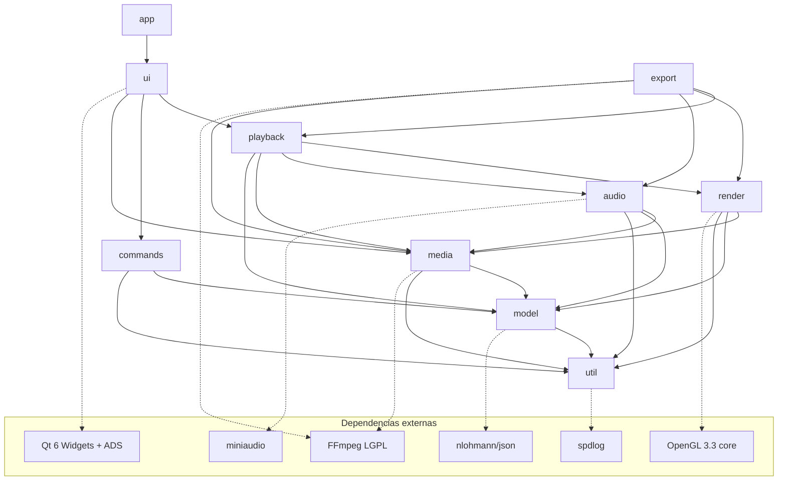
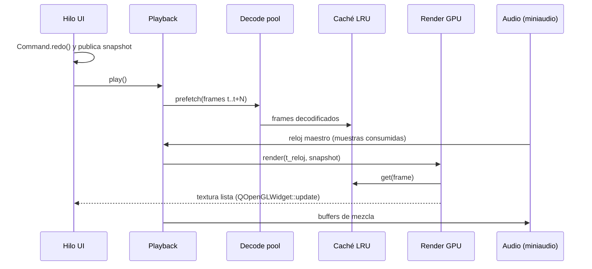

# Arquitectura de Loki

Loki es un editor de video no lineal (NLE) para PC, inspirado en el flujo de trabajo de Adobe Premiere Pro.
Este documento describe la arquitectura objetivo. Las secciones marcadas con **(decisión pendiente)** se
confirmarán antes de la fase indicada.

## 1. Principios

1. **Tiempo racional.** Toda posición/duración de edición es `loki::Rational` (numerador/denominador `int64_t`,
   normalizado, estilo `AVRational`). Prohibido `double`/`float` para tiempos de edición. `double` solo se permite
   en la frontera de presentación (píxeles de la timeline, medidores) y nunca vuelve al modelo.
2. **El modelo es la fuente de verdad** y no depende de la UI. La UI observa el modelo y lo modifica solo vía
   `Command`.
3. **Undo/redo ilimitado** (desde la Fase 2): toda mutación del modelo es un `Command` reversible.
4. **Hilos separados:** UI, decodificación (pool + caché LRU), render GPU, audio. **El reloj de audio es el maestro.**
5. **Mismo motor para preview y export.** El export usa el mismo grafo de render/mezcla, solo cambia el sumidero
   (pantalla vs. encoder) y el reloj (tiempo real vs. "lo más rápido posible").
6. **Nunca bloquear el hilo de UI** con I/O o decodificación (presupuesto: < 50 ms por evento).
7. **RAII estricto:** sin `new`/`delete` crudos, sin globales mutables. Recursos FFmpeg en `std::unique_ptr` con
   deleters dedicados (`AVFormatContextPtr`, `AVCodecContextPtr`, `AVFramePtr`, `AVPacketPtr`, ...).
8. Código, identificadores y comentarios en **inglés**; documentación de usuario en **español**.

## 2. Módulos

Cada carpeta de `src/` es una biblioteca estática CMake (`loki_<módulo>`). El ejecutable `loki` solo contiene
`app/main.cpp` y enlaza las bibliotecas. Las dependencias permitidas son **acíclicas** y se fuerzan en CMake.

| Módulo      | Responsabilidad | Depende de | Dependencias externas |
|-------------|-----------------|------------|-----------------------|
| `util`      | Logging, `Rational`, timecode, hilos/colas, helpers | — | spdlog |
| `model`     | Project, Sequence, Track, Clip, MediaItem, Effect, Keyframe, serialización | util | nlohmann/json |
| `commands`  | `Command`, `UndoStack`, comandos concretos de edición | model, util | — |
| `media`     | Probe, demux/decode FFmpeg, hwaccel, caché de fotogramas, thumbnails, waveforms, proxies | util, model (solo tipos de MediaItem) | FFmpeg |
| `render`    | Interfaz `RenderBackend`, compositor, efectos como shaders, conversión de color | util, model, media (tipos de frame) | OpenGL 3.3 (vía Qt GUI) |
| `audio`     | Mezclador, salida miniaudio, reloj maestro | util, model, media | miniaudio |
| `playback`  | Motor de reproducción: scheduling, sincronía A/V, scrubbing, J/K/L | render, audio, media, model | — |
| `export`    | Pipeline de exportación (mismo motor), presets, encoders | playback (grafo), render, audio, media | FFmpeg |
| `ui`        | Paneles: Project, SourceMonitor, ProgramMonitor, Timeline, EffectControls, AudioMeters | todos los anteriores | Qt Widgets |
| `app`       | `main`, ventana principal (dock manager), tema, workspaces, acciones y atajos | ui | Qt Widgets, Qt ADS |

Reglas:

- `model`, `commands`, `util` **no enlazan Qt Widgets**. Objetivo: tampoco Qt Core (ver §4), para que sean
  testeables y utilizables desde hilos de export sin event loop.
- `ui` nunca muta el modelo directamente: construye un `Command` y lo empuja al `UndoStack`.
- `media`, `render`, `audio` y `playback` trabajan sobre **snapshots inmutables** del modelo (ver §5), nunca
  sobre los objetos vivos que edita la UI.



## 3. Tiempo

- `loki::Rational { int64_t num; int64_t den; }` siempre normalizado (`den > 0`, `gcd == 1`), aritmética con
  detección de overflow (intermedios de 128 bits portables: MSVC no tiene `__int128`, usar helper propio),
  comparación exacta por multiplicación cruzada.
- Conversión a/desde `AVRational` en la frontera de `media`.
- La secuencia tiene `frameRate` (p. ej. `30000/1001`) y `sampleRate` de audio. Las ediciones de video se
  cuantizan a frame de secuencia; las de audio pueden ser a nivel de muestra.
- Timecode (`HH:MM:SS:FF`, drop-frame para 29.97/59.94) solo para presentación/entrada.

## 4. Modelo y comandos

**(decisión pendiente, Fase 2)** Propuesta: modelo en C++ puro (sin QObject) con un mecanismo de notificación
ligero (`ModelObserver` / eventos de cambio granulares). Un adaptador `ProjectController : QObject` en `ui`
traduce esos eventos a señales Qt. Ventajas: tests sin Qt, snapshots baratos para hilos de render/export,
sin coste de un `QObject` por clip.

```
Project
 ├─ MediaItem[]        (ruta, metadatos de probe, ruta de proxy, id estable)
 ├─ Bin[] (árbol)      (carpetas que referencian MediaItem por id)
 └─ Sequence[]
     ├─ settings       (resolución, frameRate, sampleRate)
     ├─ VideoTrack[] / AudioTrack[]  (lock, hide/mute, nombre)
     │    └─ Clip[]    (mediaId, timelineStart, sourceIn, duration, linkGroupId)
     │         └─ Effect[] → Parameter[] → Keyframe[] (tiempo Rational, valor, interpolación)
     └─ Transition[]
```

- IDs estables (`uint64_t` o UUID) para referencias cruzadas y serialización.
- `Command { virtual void redo(); virtual void undo(); virtual std::string text() const; mergeWith(...) }`.
  `UndoStack` sin límite, con macros (comandos compuestos) para ediciones como ripple/extract.
- Serialización JSON con `"version": N` en la raíz y una cadena de migraciones `vN -> vN+1` probada.

## 5. Concurrencia y flujo de datos

| Hilo | Trabajo | Comunicación |
|------|---------|--------------|
| UI (main) | Eventos, pintado de widgets, aplicación de Commands | Publica snapshot nuevo tras cada Command |
| Decode pool (N = núcleos − 2) | Demux/decode, hwaccel, escalado, thumbnails, waveforms, proxies | Colas de peticiones con prioridad; resultados a caché LRU |
| Render | Contexto GL propio (compartido con QOpenGLWidget), composición, efectos | Pide frames a la caché; entrega textura al monitor |
| Audio (callback miniaudio) | Mezcla en tiempo real, **reloj maestro** | Ring buffer lock-free alimentado por el mezclador; sin locks ni alloc en el callback |

- **Snapshot del modelo:** tras cada Command, la UI publica un `std::shared_ptr<const SequenceSnapshot>`
  (copia estructural barata). Los hilos de playback/render/export leen el puntero atómicamente. Sin locks sobre el
  modelo vivo.
- **Sincronía A/V:** el `MasterClock` avanza con las muestras efectivamente consumidas por el dispositivo de audio
  (corrigiendo la latencia reportada). El render presenta el frame cuyo PTS corresponde al reloj; si va tarde, lo
  descarta (cuenta "dropped") en vez de desincronizar. Sin audio, reloj de sistema monotónico.
- **Scrubbing:** peticiones de "último gana" (se cancelan peticiones obsoletas), seek al keyframe más cercano +
  decode hacia delante, prioridad máxima en el pool; objetivo < 100 ms.



## 6. Render

- Interfaz `RenderBackend` (crear texturas, subir planos YUV/RGBA, ejecutar pasada de efecto, leer a CPU para
  export). Implementación MVP: `GLRenderBackend` (OpenGL 3.3 core). Migración futura: QRhi / Vulkan / D3D11 sin
  tocar compositor ni efectos (los efectos declaran parámetros + shader por backend).
- Espacio de trabajo: RGBA 16F lineal; conversión YUV→RGB en shader (BT.601/709 según metadatos, rango
  limitado/completo).
- Orden por pista: decode → conversión de color → efectos de clip (Movimiento, Opacidad, color, LUT) →
  transición → mezcla con modo de fusión sobre la pista inferior.
- Calidad de reproducción (completa, 1/2, 1/4) = resolución del framebuffer de composición.

## 7. Media

- `MediaProbe` (libavformat) en el pool; nunca en UI.
- `Decoder` por stream con hwaccel en orden de preferencia: D3D11VA → NVDEC (cuvid) → QSV → software. Fallo de
  init de hwaccel = fallback silencioso a software con log.
- `FrameCache` LRU con límite en bytes (CPU) + caché de texturas pequeña en GPU.
- Thumbnails y waveforms (picos min/max por bloque) calculados en segundo plano y persistidos en caché de disco.
- Proxies 720p generados en segundo plano; `MediaItem` resuelve original/proxy de forma transparente.

## 8. Export

- Mismo grafo que playback, reloj "offline" (frame a frame), sumidero = encoder.
- Encoders H.264: `h264_nvenc` → `h264_qsv` → `h264_amf` → `libopenh264` (fallback software). AAC: encoder
  nativo `aac` de FFmpeg. Sin GPL (ver `docs/LICENSING.md`, a crear en Fase 1).
- Corre en hilo propio, con progreso y cancelación cooperativa.

## 9. Persistencia y robustez

- Proyecto `.loki` (JSON, `version`), escritura atómica (archivo temporal + rename).
- Autoguardado configurable + archivo de recuperación; al arrancar, si existe recuperación más nueva que el
  proyecto, se ofrece restaurarla.
- Workspaces: `QMainWindow::saveState` / ADS `saveState` por workspace (Edición, Color, Audio).
